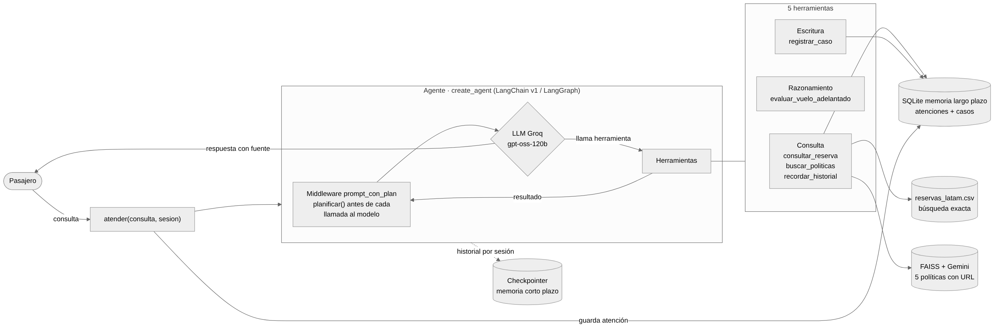
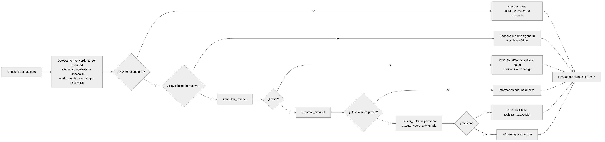

# Agente de Cuenta LATAM Airlines — Evaluación 2: Agente Funcional (ISY0101, EP2)

**Evaluación Parcial N°2 — Desarrollo de un Agente Funcional | Ingeniería de Soluciones con IA (ISY0101), Duoc UC**

**Integrantes:** Sebastián Gomez · Rafael Pacheco

[](https://colab.research.google.com/github/sebastiangome/latam-agente/blob/main/EP2_Agente_LATAM.ipynb)

Continuación del EP1 ([`LATAM_RAG_Agent.ipynb`](LATAM_RAG_Agent.ipynb)). El chatbot RAG que respondía consultas de pasajeros sobre **cambios de vuelo, equipaje y Millas LATAM Pass** pasa a ser un **agente** que consulta, razona, escribe, recuerda y planifica la atención de post-venta.

---

## 1. Requerimiento organizacional

LATAM recibe muchas consultas de post-venta repetitivas que combinan **datos de la reserva** con la **normativa vigente**. El agente automatiza el flujo de un ejecutivo de primera línea:

| Paso del ejecutivo | Cómo lo hace el agente |
|---|---|
| Identificar al pasajero | `consultar_reserva` (búsqueda exacta por código, como en el EP1) |
| Revisar atenciones y casos previos | `recordar_historial` (memoria de largo plazo) |
| Buscar la política aplicable | `buscar_politicas` (FAISS + Gemini, filtrado por tema) |
| Aplicar la regla y decidir | `evaluar_vuelo_adelantado` + planificador |
| Derivar lo que no puede resolver | `registrar_caso` para un ejecutivo humano |

Se mantienen las restricciones del EP1: datos de pasajeros **simulados**, el agente **no ejecuta transacciones** y toda respuesta **cita la fuente oficial**.

## 2. Arquitectura y orquestación



- **Framework:** LangChain v1 `create_agent`, que corre sobre LangGraph (bucle modelo → herramienta → modelo).
- **LLM:** Groq `openai/gpt-oss-120b`, con `gpt-oss-20b` y `qwen3.6-27b` de respaldo (en el EP1 Groq dio de baja `llama-3.3-70b`).
- **Middleware `prompt_con_plan`:** antes de cada llamada al modelo ejecuta `planificar()` y agrega el plan al `SYSTEM_PROMPT` del EP1.
- **Datos del EP1:** `data/reservas_latam.csv` (200 reservas) y los 5 resúmenes de políticas con su URL.

## 3. Herramientas

| Tipo | Herramienta | Qué hace |
|---|---|---|
| Consulta | `consultar_reserva` | Busca el código exacto en el CSV |
| Consulta | `buscar_politicas` | RAG sobre las 5 políticas, filtrando por tema (cambios, equipaje, millas) |
| Consulta | `recordar_historial` | Atenciones anteriores parecidas y casos abiertos del pasajero |
| Razonamiento | `evaluar_vuelo_adelantado` | Regla oficial: ≥ 16 min y ≤ 12 meses → cambio sin costo o devolución |
| Escritura | `registrar_caso` | Crea un caso con ID y prioridad en SQLite |

También se registra el alias `evalua_vuelo_adelantado`, porque en las pruebas con Groq el modelo llamó la herramienta con ese nombre y Groq rechaza los nombres que no existen.

La regla de vuelo adelantado está en código porque en el EP1 el LLM respondió "2 piezas de hasta 32 kg", cifras que no estaban en la política recuperada.

## 4. Memoria

| Tipo | Implementación |
|---|---|
| Corto plazo | `InMemorySaver` de LangGraph: guarda el historial de cada `sesion` (thread_id). Por eso entiende "es ACF657" como respuesta a la pregunta anterior |
| Largo plazo | SQLite `memoria_latam.db`: tabla `atenciones` (resumen + vector) y tabla `casos` |
| Recuperación semántica | Filtra por código de reserva y ordena las atenciones por similitud coseno con la consulta. Nunca mezcla la historia de dos pasajeros |

## 5. Planificación y toma de decisiones



`planificar()` detecta los temas, los ordena por prioridad (**alta:** vuelo adelantado, transacciones · **media:** cambios, equipaje · **baja:** millas) y arma los pasos. Se vuelve a calcular con los resultados de cada herramienta, así el agente **replanifica** cuando cambian las condiciones:

| Condición | Comportamiento |
|---|---|
| Falta el código de reserva | Responde la política general y pide el código |
| La reserva no existe | No entrega datos personales; pide revisar el código |
| Adelanto de 10 min | Informa que no aplica; no abre caso |
| Adelanto de 40 min | Agrega `registrar_caso` con prioridad alta |
| Tema sin política (ej. mascotas) | No inventa; registra caso fuera de cobertura |
| Caso abierto en una conversación nueva | Informa su estado y no lo duplica |

## 6. Ejecución

**Google Colab (recomendado):** abrir el notebook con el badge, crear los Secrets `LLM_API_KEY` ([Groq](https://console.groq.com/keys)) y `GOOGLE_API_KEY` ([Gemini](https://aistudio.google.com/apikey)) con *Notebook access* activado, y `Entorno de ejecución → Ejecutar todas`.

**Local:**
```bash
python -m venv .venv && source .venv/bin/activate   # Windows: .venv\Scripts\activate
pip install -r requirements.txt
cp .env.example .env                                # completar las dos claves
jupyter notebook EP2_Agente_LATAM.ipynb
```

El Módulo 5 incluye 10 pruebas (`assert`) del planificador y las herramientas que no usan el LLM. El Módulo 7 ejecuta los 6 escenarios de la demo.

## 7. Estructura

```text
latam-agente/
├── data/reservas_latam.csv          # 200 reservas simuladas (EP1)
├── images/                          # diagramas EP1 y EP2 (.png y fuente .mmd)
├── LATAM_RAG_Agent.ipynb            # EP1: pipeline RAG
├── EP2_Agente_LATAM.ipynb           # EP2: agente funcional
├── requirements.txt · .env.example · .gitignore
└── README.md
```

## Referencias

LangChain. (s.f.). *Agents* (LangChain v1 documentation). https://docs.langchain.com/oss/python/langchain/agents

LangChain. (s.f.). *LangGraph: Persistence*. https://docs.langchain.com/oss/python/langgraph/persistence

Groq. (s.f.). *GroqCloud: Supported models*. https://console.groq.com/docs/models

Google AI for Developers. (s.f.). *Gemini API: Embeddings*. https://ai.google.dev/gemini-api/docs/embeddings

Douze, M., Guzhva, A., Deng, C., Johnson, J., Szilvasy, G., Mazaré, P.-E., Lomeli, M., Hosseini, L., & Jégou, H. (2024). *The Faiss library*. arXiv. https://arxiv.org/abs/2401.08281

Yao, S., Zhao, J., Yu, D., Du, N., Shafran, I., Narasimhan, K., & Cao, Y. (2023). ReAct: Synergizing reasoning and acting in language models. En *International Conference on Learning Representations (ICLR 2023)*. https://arxiv.org/abs/2210.03629

LATAM Airlines. (s.f.). *Centro de Ayuda LATAM* (cambios, vuelo adelantado, equipaje, Millas LATAM Pass). https://www.latamairlines.com/cl/es/centro-ayuda

LATAM Pass. (2025). *Reglamento LATAM Pass 2025: Acumulación y canje*. https://latampass.latam.com/es_cl/reglamento-2025/acumulacion-y-canje

## Declaración de Uso Ético de IA

Este proyecto utilizó modelos de IA generativa (Claude 3.5 Sonnet / Antigravity AI) de manera ética como herramienta de apoyo para la redacción técnica, optimización de código y estructuración de diagramas, de acuerdo con las normativas de Duoc UC ([bibliotecas.duoc.cl/ia](https://bibliotecas.duoc.cl/ia)). La formulación del caso, arquitectura, justificaciones y reflexiones personales fueron realizadas íntegramente por los integrantes del equipo.
